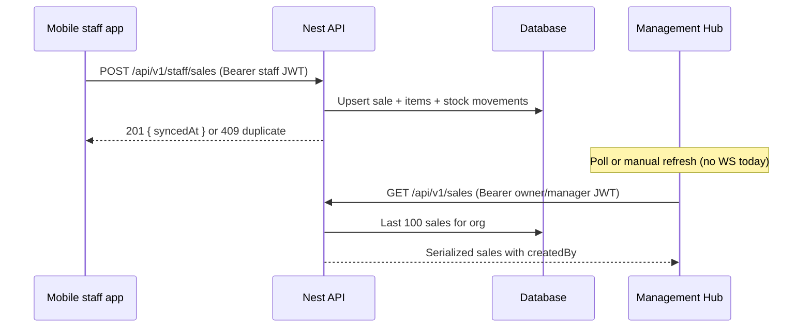
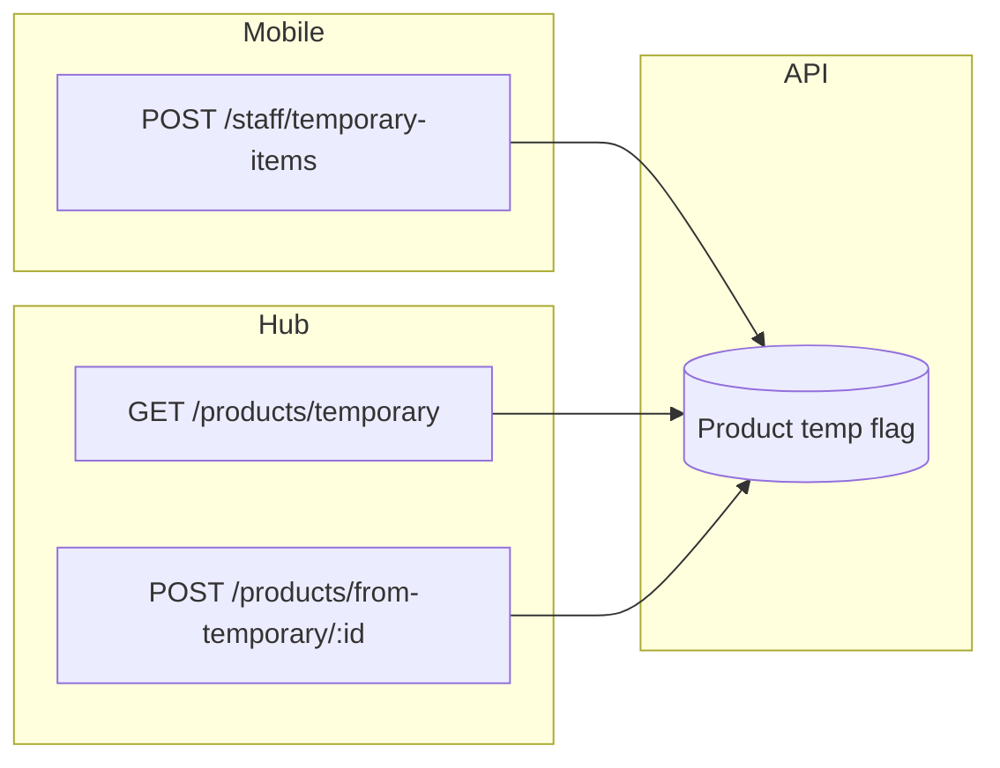
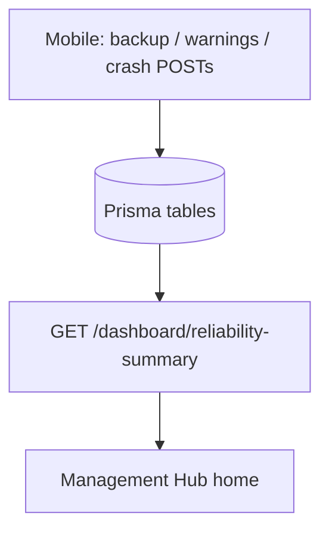

# Management Hub API Integration Guide

This guide inventories **every HTTP route** exposed by the NestJS backend (as of the repository state when authored), maps them to **Management Hub** and **mobile staff app** usage, and records gaps, priorities, and data flows. There are **no WebSocket gateways** in this codebase; all “real-time” behavior must use **polling** or a future stream until WS/SSE is added.

**Base URL conventions**

| Surface | Prefix | Notes |
|--------|--------|--------|
| Versioned API | `/api/v1` | Set in `main.ts` via `app.setGlobalPrefix('api/v1', …)` |
| Health / time | **No** `/api/v1` | Excluded from global prefix: `GET /health`, `GET /time` |

Unless stated otherwise, paths below are **relative to the API origin** and include the `/api/v1` prefix (e.g. full path `GET https://api.example.com/api/v1/sales`).

---

## Table of contents

1. [Global conventions](#global-conventions)
2. [Roles and access model](#roles-and-access-model)
3. [Endpoint inventory by organization category](#endpoint-inventory-by-organization-category)
4. [Flat endpoint index (all routes)](#flat-endpoint-index-all-routes)
5. [Per-endpoint specification (exhaustive)](#per-endpoint-specification-exhaustive)
6. [Management Hub feature map](#management-hub-feature-map)
7. [Gap analysis](#gap-analysis)
8. [Implementation priority matrix](#implementation-priority-matrix)
9. [Data flow diagrams](#data-flow-diagrams)
10. [Security considerations](#security-considerations)

---

## Global conventions

### Authentication

- **Global guard:** `JwtAuthGuard` applies to all routes except those marked `@Public()`.
- **Header:** `Authorization: Bearer <access_token>` for protected routes.
- **Tenant context:** JWT payload includes `organizationId` (nullable for platform users). Routes using `TenantGuard` require a non-null `organizationId`; otherwise `403` with *Organization context required*.
- **Role enforcement:** Controllers that use `@UseGuards(TenantGuard, RolesGuard)` also require `@Roles(…)` on each handler; if no `@Roles` metadata, `RolesGuard` allows any authenticated user (see `roles.guard.ts`).

### Public routes (no Bearer)

| Method | Path (full) | Controller |
|--------|-------------|--------------|
| `POST` | `/api/v1/auth/signup` | Auth |
| `POST` | `/api/v1/auth/login` | Auth |
| `POST` | `/api/v1/auth/staff/login` | Auth |
| `POST` | `/api/v1/auth/refresh` | Auth |
| `POST` | `/api/v1/auth/handoff` | Handoff (throttled) |
| `POST` | `/api/v1/auth/handoff/consume` | Handoff (throttled) |
| `GET` | `/health` | Health |
| `GET` | `/time` | Time |

### Request / response validation

- **ValidationPipe:** `whitelist: true`, `forbidNonWhitelisted: true`, `transform: true`. Unknown JSON fields on DTO-backed bodies return **400**.
- **JSON body limit:** 52MB (large payloads e.g. backup metadata paths).

### Error shapes (summary)

- **Most `HttpException`:** response body from Nest (often `{ statusCode, message }` or validation `{ statusCode, message: string[] }`).
- **Prisma errors:** `AllExceptionsFilter` maps e.g. `P2002` → 409, `P2025` → 404, others → 5xx with `{ success: false, statusCode, code, message }` (and optional `detail`/`meta` in non-production).

### Mobile app contract reference

Phase 1 staff app wire contract is documented in [`BACKEND_API_CONTRACT.md`](../BACKEND_API_CONTRACT.md) (paths are logical under `/api/v1`). This guide extends that with **all** backend routes and hub-oriented notes.

---

## Roles and access model

Prisma `UserRole` values used in guards:

| Role | Typical use |
|------|-------------|
| `SUPER_ADMIN` | Platform-level; **no** `organizationId` in JWT → tenant-scoped routes fail `TenantGuard` |
| `ADMIN` | Organization owner / full admin |
| `MANAGER` | Store/branch manager |
| `STAFF` | POS / operations |
| `SALES_AGENT` | External agent; included on many staff operational routes |

**Management Hub** should authenticate as **`ADMIN`** or **`MANAGER`** (and optionally `ADMIN`-only flows for destructive or role-changing actions). **`STAFF`** / **`SALES_AGENT`** tokens must not be used for owner dashboards in production.

---

## Endpoint inventory by organization category

Legend:

- **Mobile:** Used by React Native staff app (from `BACKEND_API_CONTRACT.md` and/or obvious POS flows).
- **Hub:** Should be available to the Next.js Management Hub (owner/manager).
- **Poll:** Suggested live-update strategy until WebSockets exist.

---

### Platform & connectivity (no tenant)

| Method | Path | Auth | Mobile | Hub | Purpose / hub need |
|--------|------|------|--------|-----|-------------------|
| `GET` | `/health` | Public | Optional | **P1** ops | Load balancers / uptime checks |
| `GET` | `/time` | Public | Rare | **P3** | Server time skew diagnostics |

---

### Authentication & session bridging

| Method | Path | Auth | Roles | Mobile | Hub | Request highlights | Success | Errors / notes |
|--------|------|------|-------|--------|-----|-------------------|---------|----------------|
| `POST` | `/auth/signup` | Public | — | No | **P1** | `SignupDto` | New user/org | 400 validation |
| `POST` | `/auth/login` | Public | — | No | **P0** | Email/password owner login | Tokens + user | 401 invalid |
| `POST` | `/auth/staff/login` | Public | — | **Yes** | No (staff only) | `staffId`, `password` | Staff JWT | 401 |
| `POST` | `/auth/staff/change-password` | JWT | — | **Yes** | Rare | `currentPassword`, `newPassword` | 200 | 400/401 |
| `POST` | `/auth/refresh` | Public | — | **Yes** | **P0** | `refresh_token` or `refreshToken` | New access token | 401 refresh invalid |
| `POST` | `/auth/staff/bind-device` | JWT | — | **Yes** | No | `BindDeviceDto` + fingerprint hash rules | 200 device bind | 400 hash mismatch |
| `POST` | `/auth/handoff` | Public + throttle | — | No | **P0** | `{ refreshToken }` | Short-lived handoff for web | Rate limited |
| `POST` | `/auth/handoff/consume` | Public + throttle | — | No | **P0** | `{ code }` | Exchange code for tokens | Rate limited |

**Real-time:** None. Hub should refresh tokens before expiry and handle 401 → refresh flow.

---

### Users (identity directory)

| Method | Path | Auth | Roles | Mobile | Hub | Query / body | Response / use |
|--------|------|------|-------|--------|-----|--------------|----------------|
| `GET` | `/users/me` | JWT + tenant | Any with org | Optional | **P0** | — | Current user profile |
| `GET` | `/users` | JWT + tenant | ADMIN, MANAGER, STAFF | **Yes** (list peers) | **P0** | — | Staff directory (hub: read-only directory) |
| `POST` | `/users` | JWT + tenant | ADMIN, MANAGER | No | **P1** | `CreateUserDto` | Create staff user (overlaps with `/staff` CRUD—see gaps) |

**Pagination / search:** **Not implemented** on `GET /users` — hub may need client-side filter or backend extension.

---

### Organizations (business profile)

| Method | Path | Auth | Roles | Mobile | Hub | Body | Response / use |
|--------|------|------|-------|--------|-----|------|----------------|
| `GET` | `/organizations/me` | JWT + tenant | ADMIN, MANAGER, STAFF | **Yes** (sync context) | **P0** | — | Org settings, plan, tax flags |
| `PATCH` | `/organizations/me` | JWT + tenant | ADMIN, MANAGER | No | **P0** | `UpdateOrganizationDto` | Update business metadata, tax, currency |

**Real-time:** Poll after saves; broadcast not available.

---

### Dashboard (aggregated KPIs)

| Method | Path | Auth | Roles | Mobile | Hub | Response / use |
|--------|------|------|-------|--------|-----|------------------|
| `GET` | `/dashboard/summary` | JWT + tenant | ADMIN, MANAGER | No | **P0** | Counts: total/today sales & revenue, low stock, expiring batches (90d window), pending temporary products |
| `GET` | `/dashboard/reliability-summary` | JWT + tenant | ADMIN, MANAGER | No | **P1** | Backups, storage warnings, DB warnings, crash counts (rolling windows) |

**Real-time:** **Poll** (e.g. 30s–2m) for home widgets; lower frequency for reliability.

---

### Sales

| Method | Path | Auth | Roles | Mobile | Hub | Body / query | Response / use |
|--------|------|------|-------|--------|-----|--------------|----------------|
| `GET` | `/sales` | JWT + tenant | ADMIN, MANAGER, STAFF | Partial | **P0** | — | Last **100** sales, serialized with items + `createdBy` (no pagination params) |
| `POST` | `/sales` | JWT + tenant | ADMIN, MANAGER, STAFF | Possible | **P1** | `CreateSaleDto`: `items[]` { `productId`, `quantity` }, optional `paymentMethod`, `soldAt`, `discountAmount` | Server-side stock + tax calculation; creates sale |

| Method | Path | Auth | Roles | Mobile | Hub | Body / notes |
|--------|------|------|-------|--------|-----|----------------|
| `POST` | `/staff/sales` | JWT + tenant | ADMIN, MANAGER, STAFF, SALES_AGENT | **Yes** | **P0** view | `StaffSaleUploadDto`: client-generated sale `id`, receipt fields, totals, `items[]`, `deviceInfo`, etc. |

**`POST /staff/sales` responses:** `201` created with `{ syncedAt, synced_at }`; **`409`** duplicate idempotency (same body semantics as success for client). Hub should treat 409 as “already recorded.”

**Real-time:** No push. Hub **must poll** `GET /sales` or future filtered feed; note **100 sale cap** and no date filter.

---

### Staff administration (HR / permissions)

Controller: `staff.controller.ts` — all `ADMIN`/`MANAGER` unless noted.

| Method | Path | Roles | Mobile | Hub | Query / body | Notes |
|--------|------|-------|--------|-----|--------------|-------|
| `POST` | `/staff` | ADMIN, MANAGER | No | **P0** | `CreateStaffDto` | Create staff account |
| `GET` | `/staff` | ADMIN, MANAGER | No | **P0** | `?includeInactive=true` optional | List staff |
| `GET` | `/staff/performance` | ADMIN, MANAGER | No | **P1** | `?from`, `?to` ISO strings | Performance metrics |
| `GET` | `/staff/:id` | ADMIN, MANAGER | No | **P0** | — | Staff detail |
| `PATCH` | `/staff/:id` | ADMIN, MANAGER | No | **P0** | `UpdateStaffDto` | Update profile/status |
| `DELETE` | `/staff/:id` | ADMIN, MANAGER | No | **P1** | — | Deactivate staff |
| `POST` | `/staff/:id/reset-password` | ADMIN, MANAGER | No | **P0** | — | Issue reset |
| `PATCH` | `/staff/:id/role` | **ADMIN only** | No | **P0** | `ChangeStaffRoleDto` | Elevate/demote roles |
| `POST` | `/staff/:id/set-permissions` | ADMIN, MANAGER | No | **P1** | `SetStaffPermissionsDto` | Fine-grained permissions |
| `GET` | `/staff/:id/activity-log` | ADMIN, MANAGER | No | **P1** | `?page`, `?limit` | Paginated activity |

**Pagination:** Activity log supports `page`/`limit`; list endpoints do not.

---

### Staff POS & sync (catalog / trial)

| Method | Path | Roles | Mobile | Hub | Notes |
|--------|------|-------|--------|-----|-------|
| `GET` | `/staff/inventory` | ADMIN, MANAGER, STAFF, SALES_AGENT | **Yes** | **P2** read | `{ products }` |
| `GET` | `/staff/pricing` | same | **Yes** | **P2** | Same payload shape as inventory in practice |
| `GET` | `/staff/settings/tax` | same | **Yes** | **P1** read | Tax defaults for POS |
| `GET` | `/staff/categories` | same | **Yes** | **P2** read | Category list for POS |
| `GET` | `/staff/trial/status` | same | **Yes** | **P1** | Trial usage reconciliation |
| `GET` | `/sync/initial-pull` | ADMIN, MANAGER, STAFF, SALES_AGENT | **Yes** | **P2** | Bulk org + products (+ categories) for offline |

| Method | Path | Roles | Mobile | Hub | Query / body |
|--------|------|-------|--------|-----|----------------|
| `GET` | `/staff/master-data` | ADMIN, MANAGER, STAFF, SALES_AGENT | **Yes** | **P2** | `?since` optional cursor for delta sync |

**Hub use:** Mostly read-only insight into what staff devices pull; useful for support/debug—not core owner UX.

---

### Staff mobile operations (returns, adjustments, telemetry)

| Method | Path | Roles | Mobile | Hub |
|--------|------|-------|--------|-----|
| `POST` | `/staff/temporary-items` | ADMIN, MANAGER, STAFF, SALES_AGENT | **Yes** | **P1** audit | `StaffTemporaryItemDto` |
| `POST` | `/staff/returns` | same | **Yes** | **P1** audit | `StaffReturnDto` |
| `POST` | `/staff/inventory-events` | same | **Yes** | **P1** audit | `StaffInventoryEventDto` |
| `POST` | `/staff/time-warning` | same | **Yes** | **P2** | `StaffTimeWarningDto` |
| `POST` | `/staff/stock-adjustments` | same | **Yes** | **P1** audit | `StaffStockAdjustmentDto` |

**Hub:** Owners do not POST these; they need **read APIs** listing temporary items, returns, adjustments (partially covered via products, audit—see gaps).

---

### Staff reliability & backups

| Method | Path | Roles | Mobile | Hub | Notes |
|--------|------|-------|--------|-----|-------|
| `GET` | `/staff/backups` | ADMIN, MANAGER | No | **P1** | Query: `StaffBackupsListQueryDto` — `from`, `to`, `userId`, `limit` (1–100), `cursor`, `deviceId` |
| `GET` | `/staff/device-warnings` | ADMIN, MANAGER | No | **P1** | `StaffReliabilityListQueryDto` |
| `GET` | `/staff/database-warnings` | ADMIN, MANAGER | No | **P1** | same |
| `POST` | `/staff/backup` | ADMIN, MANAGER, STAFF, SALES_AGENT | **Yes** | No | **Multipart:** field `backup` (file, max ~52MB), body `device_id`, `app_version`, optional `build_number`, `created_at` → **201** |
| `GET` | `/staff/backup/:id` | ADMIN, MANAGER, STAFF, SALES_AGENT | Optional | **P2** support | File download stream; staff limited to own uploads |
| `POST` | `/staff/device-warning` | ADMIN, MANAGER, STAFF, SALES_AGENT | **Yes** | No | **204** |
| `POST` | `/staff/database-warning` | same | **Yes** | No | **204** |

**Pagination:** Keyset cursor pattern; responses include `items` + `nextCursor` (see reliability query service).

---

### Products & inventory

| Method | Path | Roles | Mobile | Hub | Query / body |
|--------|------|-------|--------|-----|--------------|
| `GET` | `/products` | ADMIN, MANAGER, STAFF | **Yes** (filtered) | **P0** | `QueryProductsDto`: `page`, `limit` (max 100), `search`, `categoryId`, `lowStock`, `includeInactive`, `sortBy`, `sortOrder` |
| `GET` | `/products/low-stock` | ADMIN, MANAGER | No | **P0** | — |
| `GET` | `/products/expiring-soon` | ADMIN, MANAGER | No | **P1** | `?months` default 3 |
| `POST` | `/products/from-temporary/:productId` | ADMIN, MANAGER | No | **P0** | `PromoteFromTemporaryDto` — promote temp line to catalog |
| `GET` | `/products/temporary` | ADMIN, MANAGER, STAFF | **Yes** | **P0** | Pending temp SKUs |
| `GET` | `/products/:id` | ADMIN, MANAGER, STAFF | **Yes** | **P0** | — |
| `GET` | `/products/:id/stock-history` | ADMIN, MANAGER | No | **P1** | `?page`, `?limit` |
| `GET` | `/products/:id/inventory-events` | ADMIN, MANAGER | No | **P1** | `?page`, `?limit` |
| `POST` | `/products` | ADMIN, MANAGER, STAFF | **Yes** | **P0** | `CreateProductDto` |
| `PATCH` | `/products/:id` | ADMIN, MANAGER, STAFF | **Yes** | **P0** | `UpdateProductDto` |
| `DELETE` | `/products/:id` | ADMIN, MANAGER | No | **P1** | Soft delete pattern in service |
| `PATCH` | `/products/:id/pricing` | ADMIN, MANAGER | No | **P0** | `UpdatePricingDto` |
| `POST` | `/products/:id/duplicate` | ADMIN, MANAGER | No | **P2** | Optional body `{ sku }` |

**Search / filter:** `GET /products` is the primary hub list endpoint with search and sort.

---

### Categories

| Method | Path | Roles | Mobile | Hub | Query / body |
|--------|------|-------|--------|-----|--------------|
| `POST` | `/categories` | ADMIN, MANAGER | No | **P0** | `CreateCategoryDto` |
| `GET` | `/categories` | ADMIN, MANAGER, STAFF | **Yes** | **P0** | `QueryCategoriesDto`: optional `search` |
| `GET` | `/categories/:id` | ADMIN, MANAGER, STAFF | **Yes** | **P0** | — |
| `GET` | `/categories/:id/products` | ADMIN, MANAGER, STAFF | **Yes** | **P1** | Products in category |
| `PATCH` | `/categories/:id` | ADMIN, MANAGER | No | **P0** | `UpdateCategoryDto` |
| `DELETE` | `/categories/:id` | ADMIN, MANAGER | No | **P1** | — |

---

### Batches (expiry / lot-style inventory)

| Method | Path | Roles | Mobile | Hub | Query / body |
|--------|------|-------|--------|-----|--------------|
| `POST` | `/batches` | ADMIN, MANAGER | No | **P1** | `CreateBatchDto` |
| `GET` | `/batches` | ADMIN, MANAGER, STAFF | **Yes** | **P1** | `QueryBatchesDto`: page, limit, `productId`, `expiryDateFrom`/`To`, `isExpired`, `onlyExpiringSoon` |
| `GET` | `/batches/expiring` | ADMIN, MANAGER | No | **P1** | `?days` default 30 |
| `GET` | `/batches/expired` | ADMIN, MANAGER | No | **P1** | — |
| `GET` | `/batches/:id` | ADMIN, MANAGER, STAFF | **Yes** | **P1** | — |
| `PATCH` | `/batches/:id` | ADMIN, MANAGER | No | **P1** | `UpdateBatchDto` |
| `DELETE` | `/batches/:id` | ADMIN, MANAGER | No | **P2** | — |
| `POST` | `/batches/:id/remove-expired` | ADMIN, MANAGER | No | **P2** | Stock maintenance |

---

### Analytics (mobile telemetry + hub diagnostics)

| Method | Path | Roles | Mobile | Hub | Query / body |
|--------|------|-------|--------|-----|--------------|
| `GET` | `/analytics/crashes` | ADMIN, MANAGER | No | **P1** | `StaffReliabilityListQueryDto` |
| `GET` | `/analytics/crashes/:id` | ADMIN, MANAGER | No | **P1** | Includes stack trace detail |
| `GET` | `/analytics/performance` | ADMIN, MANAGER | No | **P2** | Paginated performance events |
| `POST` | `/analytics/performance` | ADMIN, MANAGER, STAFF, SALES_AGENT | **Yes** | No | `MobilePerformanceDto` |
| `POST` | `/analytics/crash` | ADMIN, MANAGER, STAFF, SALES_AGENT | **Yes** | No | `MobileCrashDto` |

---

### Notifications (owner inbox)

| Method | Path | Roles | Mobile | Hub | Query |
|--------|------|-------|--------|-----|-------|
| `GET` | `/notifications` | ADMIN, MANAGER | No | **P1** | `?unread=true`, `?limit`, `?cursor` |
| `PATCH` | `/notifications/:id/read` | ADMIN, MANAGER | No | **P1** | Mark single read |

**Real-time:** Poll unread count; no WS.

---

### Audit log

| Method | Path | Roles | Mobile | Hub | Query |
|--------|------|-------|--------|-----|-------|
| `GET` | `/audit/events` | ADMIN, MANAGER | No | **P0** | `?cursor`, `?limit` |

**Use:** Compliance trail for sensitive changes; pair with staff activity for investigations.

---

### Customer management

**No dedicated customer or CRM endpoints** exist. Sales reference products and staff; there is no `/customers` resource.

---

## Flat endpoint index (all routes)

**Total:** **84** HTTP operations (**82** under `/api/v1`, **2** health/time without prefix).

### `/api/v1` — alphabetical by first path segment

**`analytics` (6)**  
`GET /analytics/crashes` · `GET /analytics/crashes/:id` · `GET /analytics/performance` · `POST /analytics/crash` · `POST /analytics/performance`

**`audit` (1)**  
`GET /audit/events`

**`auth` (8)**  
`POST /auth/handoff` · `POST /auth/handoff/consume` · `POST /auth/login` · `POST /auth/refresh` · `POST /auth/signup` · `POST /auth/staff/bind-device` · `POST /auth/staff/change-password` · `POST /auth/staff/login`

**`batches` (8)**  
`DELETE /batches/:id` · `GET /batches` · `GET /batches/expired` · `GET /batches/expiring` · `GET /batches/:id` · `PATCH /batches/:id` · `POST /batches` · `POST /batches/:id/remove-expired`

**`categories` (6)**  
`DELETE /categories/:id` · `GET /categories` · `GET /categories/:id` · `GET /categories/:id/products` · `PATCH /categories/:id` · `POST /categories`

**`dashboard` (2)**  
`GET /dashboard/reliability-summary` · `GET /dashboard/summary`

**`notifications` (2)**  
`GET /notifications` · `PATCH /notifications/:id/read`

**`organizations` (2)**  
`GET /organizations/me` · `PATCH /organizations/me`

**`products` (12)**  
`DELETE /products/:id` · `GET /products` · `GET /products/expiring-soon` · `GET /products/low-stock` · `GET /products/temporary` · `GET /products/:id` · `GET /products/:id/inventory-events` · `GET /products/:id/stock-history` · `PATCH /products/:id` · `PATCH /products/:id/pricing` · `POST /products` · `POST /products/:id/duplicate` · `POST /products/from-temporary/:productId`

**`sales` (2)**  
`GET /sales` · `POST /sales`

**`staff` (29)** — merged from `StaffPosController`, `StaffMobileController`, `StaffReliabilityController`, `StaffController`, `StaffSalesController`  

`DELETE /staff/:id` · `GET /staff` · `GET /staff/backup/:id` · `GET /staff/backups` · `GET /staff/categories` · `GET /staff/database-warnings` · `GET /staff/device-warnings` · `GET /staff/inventory` · `GET /staff/master-data` · `GET /staff/performance` · `GET /staff/pricing` · `GET /staff/settings/tax` · `GET /staff/trial/status` · `GET /staff/:id` · `GET /staff/:id/activity-log` · `PATCH /staff/:id` · `PATCH /staff/:id/role` · `POST /staff` · `POST /staff/backup` · `POST /staff/database-warning` · `POST /staff/device-warning` · `POST /staff/inventory-events` · `POST /staff/returns` · `POST /staff/sales` · `POST /staff/stock-adjustments` · `POST /staff/temporary-items` · `POST /staff/time-warning` · `POST /staff/:id/reset-password` · `POST /staff/:id/set-permissions`

**`sync` (1)**  
`GET /sync/initial-pull`

**`users` (3)**  
`GET /users` · `GET /users/me` · `POST /users`

### Outside `/api/v1`

- `GET /health`  
- `GET /time`

---

## Per-endpoint specification (exhaustive)

Common headers for JSON endpoints: `Content-Type: application/json`; protected routes: `Authorization: Bearer <access_token>`. Unless noted, errors include **401** (missing/invalid JWT), **403** (wrong role or missing org context on tenant routes), **400** (validation / `ValidationPipe`).

### Platform

#### `GET /health`

- **Auth:** Public · **Roles:** — · **Query/Body:** none
- **Success:** `200` — service health payload (implementation-specific)
- **Errors:** — · **Mobile:** No · **Hub:** Ops (P1) · **Live:** N/A

#### `GET /time`

- **Auth:** Public · **Roles:** — · **Query/Body:** none
- **Success:** `200` — server time
- **Mobile:** No · **Hub:** P3 diagnostics · **Live:** N/A

---

### Auth (`/api/v1/auth`)

#### `POST /api/v1/auth/signup`

- **Auth:** Public · **Body:** `SignupDto` — `email`, `password` (min 8), `organizationName`; optional `firstName`, `lastName`, `phoneNumber`, `businessType`, `businessLocation`, `leadSource`, `branchCount` (int ≥ 0)
- **Success:** `201`/`200` (per `AuthService`) — user + tokens + org bootstrap
- **Errors:** `400` validation; `409` email exists (if enforced)
- **Mobile:** No · **Hub:** Owner onboarding (P1) · **Live:** N/A

#### `POST /api/v1/auth/login`

- **Auth:** Public · **Body:** `LoginDto` — `email`, `password`
- **Success:** `200` — access + refresh + user with `organizationId`
- **Errors:** `401` invalid credentials
- **Mobile:** No · **Hub:** **P0** session · **Live:** N/A

#### `POST /api/v1/auth/staff/login`

- **Auth:** Public · **Body:** `StaffLoginDto` — `staffId`, `password` (see contract for response shape)
- **Success:** `200` — staff JWT + `user` + `staffProfile` / `staff_profile`
- **Errors:** `401` · **Mobile:** **P0** · **Hub:** Do not use

#### `POST /api/v1/auth/staff/change-password`

- **Auth:** JWT · **Body:** `StaffChangePasswordDto` — `currentPassword`, `newPassword`
- **Success:** `200`
- **Errors:** `400` weak/wrong password · **Mobile:** **Yes** · **Hub:** Rare

#### `POST /api/v1/auth/refresh`

- **Auth:** Public · **Body:** `StaffRefreshDto` / alternate keys — `refresh_token` or `refreshToken` required
- **Success:** `200` — new `access_token` / `accessToken`
- **Errors:** `400` missing token; `401` invalid refresh
- **Mobile:** **Yes** · **Hub:** **P0**

#### `POST /api/v1/auth/staff/bind-device`

- **Auth:** JWT · **Body:** `BindDeviceDto` — nested `deviceFingerprint`, `deviceUuid`, `fingerprintHash` (64 hex SHA-256 of canonical JSON per contract), `timestamp` ISO8601
- **Success:** `200` — `{ deviceId? }`
- **Errors:** `400` hash mismatch / validation · **Mobile:** **Yes** · **Hub:** No

#### `POST /api/v1/auth/handoff`

- **Auth:** Public · **Guards:** `ThrottlerGuard` — limit 15/min per config · **Body:** `RefreshDto` — `refreshToken` (min length 10)
- **Success:** `200`/`201` — short-lived handoff payload (see `HandoffService`)
- **Errors:** `429` throttle · **Mobile:** No · **Hub:** **P0** web session bridge

#### `POST /api/v1/auth/handoff/consume`

- **Auth:** Public · **Throttle:** 30/min · **Body:** `HandoffConsumeDto` — `code` (min 8 chars)
- **Success:** `200` — tokens for hub session
- **Errors:** `400`/`401` invalid code · **Hub:** **P0**

---

### Users (`/api/v1/users`)

#### `GET /api/v1/users/me`

- **Auth:** JWT + `TenantGuard` · **Roles:** (none on handler — any authenticated user with org)
- **Success:** `200` — profile from `UsersService.getMe`
- **Errors:** `403` no org · **Mobile:** Optional · **Hub:** **P0**

#### `GET /api/v1/users`

- **Auth:** JWT + tenant · **Roles:** `ADMIN`, `MANAGER`, `STAFF`
- **Success:** `200` — staff list (`listStaff`)
- **Mobile:** Yes (peer list) · **Hub:** **P0** directory · **Pagination:** none

#### `POST /api/v1/users`

- **Auth:** JWT + tenant · **Roles:** `ADMIN`, `MANAGER` · **Body:** `CreateUserDto`
- **Success:** `201`/`200` — created user
- **Hub:** **P1** (overlaps `POST /staff` — align product UX)

---

### Organizations (`/api/v1/organizations`)

#### `GET /api/v1/organizations/me`

- **Auth:** JWT + tenant · **Roles:** `ADMIN`, `MANAGER`, `STAFF`
- **Success:** `200` — org + plan + tax fields (see Prisma `Organization`)
- **Mobile:** Sync context · **Hub:** **P0**

#### `PATCH /api/v1/organizations/me`

- **Auth:** JWT + tenant · **Roles:** `ADMIN`, `MANAGER` · **Body:** `UpdateOrganizationDto` — optional `name`, `businessType`, `businessLocation`, `leadSource`, `phone`, `email`
- **Success:** `200` — updated org
- **Hub:** **P0** business profile

---

### Dashboard (`/api/v1/dashboard`)

#### `GET /api/v1/dashboard/summary`

- **Auth:** JWT + tenant · **Roles:** `ADMIN`, `MANAGER` · **Query:** none
- **Success:** `200` — `{ totalSales, totalRevenue, todaySales, todayRevenue, lowStockCount, expiringSoonCount, pendingTemporaryItems }` (numbers)
- **Hub:** **P0** · **Live:** Poll

#### `GET /api/v1/dashboard/reliability-summary`

- **Auth:** JWT + tenant · **Roles:** `ADMIN`, `MANAGER`
- **Success:** `200` — nested `backups`, `lowStorage`, `database`, `crashes` with counts + ISO timestamps (see `DashboardService`)
- **Hub:** **P1** · **Live:** Poll

---

### Sales (`/api/v1/sales` and staff upload)

#### `GET /api/v1/sales`

- **Auth:** JWT + tenant · **Roles:** `ADMIN`, `MANAGER`, `STAFF`
- **Success:** `200` — array of serialized sales (max **100**, `soldAt` desc) with `items` + `createdBy`
- **Hub:** **P0** · **Gaps:** no `from`/`to`/cursor · **Live:** Poll

#### `POST /api/v1/sales`

- **Auth:** JWT + tenant · **Roles:** `ADMIN`, `MANAGER`, `STAFF` · **Body:** `CreateSaleDto`
- **Success:** `201`/`200` — created sale (see `SalesService`)
- **Errors:** `404` product; `400` insufficient stock · **Hub:** Optional register-style sale entry

#### `POST /api/v1/staff/sales`

- **Auth:** JWT + tenant · **Roles:** `ADMIN`, `MANAGER`, `STAFF`, `SALES_AGENT` · **Body:** `StaffSaleUploadDto` (sale id, receipt, totals, `items[]`, `paymentMethod`, `currency`, `soldAt`, optional `deviceInfo`, …)
- **Success:** `201` — `{ syncedAt, synced_at }` · **Duplicate:** `409` same body (idempotent)
- **Errors:** `400` business validation · **Mobile:** **Primary sale upload** · **Hub:** Read via `GET /sales` · **Live:** Poll

---

### Staff — administration (`StaffController`)

| Endpoint | Method | Roles | Query / params | Body | Success | Hub / mobile |
|----------|--------|-------|------------------|------|---------|--------------|
| `/staff` | `POST` | ADMIN, MANAGER | — | `CreateStaffDto` | Created staff | Hub P0 / mobile no |
| `/staff` | `GET` | ADMIN, MANAGER | `includeInactive=true` | — | Staff array | Hub P0 |
| `/staff/performance` | `GET` | ADMIN, MANAGER | `from`, `to` ISO | — | Metrics | Hub P1 |
| `/staff/:id` | `GET` | ADMIN, MANAGER | — | `:id` UUID | Detail | Hub P0 |
| `/staff/:id` | `PATCH` | ADMIN, MANAGER | — | `UpdateStaffDto` | Updated | Hub P0 |
| `/staff/:id` | `DELETE` | ADMIN, MANAGER | — | — | Deactivated | Hub P1 |
| `/staff/:id/reset-password` | `POST` | ADMIN, MANAGER | — | — | Temp password / ack | Hub P0 |
| `/staff/:id/role` | `PATCH` | **ADMIN only** | — | `ChangeStaffRoleDto` | Updated role | Hub P0 |
| `/staff/:id/set-permissions` | `POST` | ADMIN, MANAGER | — | `SetStaffPermissionsDto` | Updated | Hub P1 |
| `/staff/:id/activity-log` | `GET` | ADMIN, MANAGER | `page`, `limit` | — | Paginated log | Hub P1 |

**Errors:** `:id` not UUID → `400`; not found → `404`.

---

### Staff — POS & sync (`StaffPosController`, `SyncController`)

| Endpoint | Roles | Mobile | Hub | Notes |
|----------|-------|--------|-----|-------|
| `GET /staff/inventory` | All POS roles | **Yes** | P2 debug | `{ products }` |
| `GET /staff/pricing` | same | **Yes** | P2 | `{ products }` |
| `GET /staff/settings/tax` | same | **Yes** | P1 read | Tax JSON |
| `GET /staff/categories` | same | **Yes** | P2 | `{ categories: [...] }` |
| `GET /staff/trial/status` | same | **Yes** | P1 | Trial counters |
| `GET /sync/initial-pull` | ADMIN, MANAGER, STAFF, SALES_AGENT | **Yes** | P3 | Bulk snapshot |

---

### Staff — mobile writes (`StaffMobileController`)

| Endpoint | Method | Roles | Body DTO | Success | Mobile | Hub |
|----------|--------|-------|----------|---------|--------|-----|
| `/staff/master-data` | `GET` | POS roles | — | `?since` | Catalog delta | **Yes** | P2 |
| `/staff/temporary-items` | `POST` | POS roles | `StaffTemporaryItemDto` | `200` | **Yes** | Audit only (no GET) |
| `/staff/returns` | `POST` | POS roles | `StaffReturnDto` | `200` | **Yes** | Audit gap |
| `/staff/inventory-events` | `POST` | POS roles | `StaffInventoryEventDto` | `200` | **Yes** | Use product events GET |
| `/staff/time-warning` | `POST` | POS roles | `StaffTimeWarningDto` | `200` | **Yes** | No list API |
| `/staff/stock-adjustments` | `POST` | POS roles | `StaffStockAdjustmentDto` | `200` | **Yes** | Partial visibility |

---

### Staff — reliability (`StaffReliabilityController`)

| Endpoint | Method | Roles | Request | Success | Notes |
|----------|--------|-------|---------|---------|-------|
| `/staff/backups` | `GET` | ADMIN, MANAGER | `StaffBackupsListQueryDto` | `{ items, nextCursor }` | Filter staff/device |
| `/staff/device-warnings` | `GET` | ADMIN, MANAGER | `StaffReliabilityListQueryDto` | cursor page | |
| `/staff/database-warnings` | `GET` | ADMIN, MANAGER | same | cursor page | |
| `/staff/backup` | `POST` | POS roles | **multipart** `backup` + `StaffBackupMultipartDto` fields | `201` | Mobile upload |
| `/staff/backup/:id` | `GET` | POS roles | `:id` UUID | **Stream** file | Sensitive download |
| `/staff/device-warning` | `POST` | POS roles | `StaffDeviceWarningDto` | **204** | Telemetry |
| `/staff/database-warning` | `POST` | POS roles | `StaffDatabaseWarningDto` | **204** | Telemetry |

**Query DTO shared fields:** optional `from`, `to` (ISO date), `userId` (UUID), `limit` 1–100 (default 20), `cursor` opaque; backups list also `deviceId`.

---

### Products (`/api/v1/products`)

| Endpoint | Method | Roles | Query / params / body | Success |
|----------|--------|-------|------------------------|---------|
| `/products` | `GET` | ADMIN, MANAGER, STAFF | `QueryProductsDto` | Paginated list |
| `/products/low-stock` | `GET` | ADMIN, MANAGER | — | Low-stock rows |
| `/products/expiring-soon` | `GET` | ADMIN, MANAGER | `?months` | Soon-expiring |
| `/products/from-temporary/:productId` | `POST` | ADMIN, MANAGER | `PromoteFromTemporaryDto` | `200` promote |
| `/products/temporary` | `GET` | ADMIN, MANAGER, STAFF | — | Temp products |
| `/products/:id` | `GET` | ADMIN, MANAGER, STAFF | UUID | One product |
| `/products/:id/stock-history` | `GET` | ADMIN, MANAGER | `page`, `limit` | Paginated |
| `/products/:id/inventory-events` | `GET` | ADMIN, MANAGER | `page`, `limit` | Paginated |
| `/products` | `POST` | ADMIN, MANAGER, STAFF | `CreateProductDto` | Created |
| `/products/:id` | `PATCH` | ADMIN, MANAGER, STAFF | `UpdateProductDto` | Updated |
| `/products/:id` | `DELETE` | ADMIN, MANAGER | — | Removed/deactivated |
| `/products/:id/pricing` | `PATCH` | ADMIN, MANAGER | `UpdatePricingDto` | Updated |
| `/products/:id/duplicate` | `POST` | ADMIN, MANAGER | optional JSON `{ sku }` | Duplicate |

**Hub:** P0 list + mutations for owners; staff can create/update products per role matrix.

---

### Categories (`/api/v1/categories`)

| Endpoint | Method | Roles | Query / body |
|----------|--------|-------|--------------|
| `/categories` | `POST` | ADMIN, MANAGER | `CreateCategoryDto` |
| `/categories` | `GET` | ADMIN, MANAGER, STAFF | `QueryCategoriesDto` (`search`) |
| `/categories/:id` | `GET` | ADMIN, MANAGER, STAFF | — |
| `/categories/:id/products` | `GET` | ADMIN, MANAGER, STAFF | — |
| `/categories/:id` | `PATCH` | ADMIN, MANAGER | `UpdateCategoryDto` |
| `/categories/:id` | `DELETE` | ADMIN, MANAGER | — |

---

### Batches (`/api/v1/batches`)

| Endpoint | Method | Roles | Query / body |
|----------|--------|-------|--------------|
| `/batches` | `POST` | ADMIN, MANAGER | `CreateBatchDto` |
| `/batches` | `GET` | ADMIN, MANAGER, STAFF | `QueryBatchesDto` (pagination + filters) |
| `/batches/expiring` | `GET` | ADMIN, MANAGER | `?days` (default 30) |
| `/batches/expired` | `GET` | ADMIN, MANAGER | — |
| `/batches/:id` | `GET` | ADMIN, MANAGER, STAFF | UUID |
| `/batches/:id` | `PATCH` | ADMIN, MANAGER | `UpdateBatchDto` |
| `/batches/:id` | `DELETE` | ADMIN, MANAGER | — |
| `/batches/:id/remove-expired` | `POST` | ADMIN, MANAGER | — |

---

### Analytics (`/api/v1/analytics`)

| Endpoint | Method | Roles | Body / query |
|----------|--------|-------|----------------|
| `/analytics/crashes` | `GET` | ADMIN, MANAGER | `StaffReliabilityListQueryDto` |
| `/analytics/crashes/:id` | `GET` | ADMIN, MANAGER | — (includes `stack`) |
| `/analytics/performance` | `GET` | ADMIN, MANAGER | `StaffReliabilityListQueryDto` |
| `/analytics/performance` | `POST` | POS roles | `MobilePerformanceDto` |
| `/analytics/crash` | `POST` | POS roles | `MobileCrashDto` |

---

### Notifications (`/api/v1/notifications`)

| Endpoint | Method | Roles | Query | Success |
|----------|--------|-------|-------|---------|
| `/notifications` | `GET` | ADMIN, MANAGER | `unread`, `limit`, `cursor` | Cursor list |
| `/notifications/:id/read` | `PATCH` | ADMIN, MANAGER | UUID | Read state |

---

### Audit (`/api/v1/audit`)

| Endpoint | Method | Roles | Query |
|----------|--------|-------|-------|
| `/audit/events` | `GET` | ADMIN, MANAGER | `cursor`, `limit` |

---

## Management Hub feature map

### FEATURE: Executive overview (home)

| Priority | Purpose |
|----------|---------|
| **P0** | At-a-glance revenue, orders, risk flags |

**Endpoints**

- `GET /dashboard/summary`
- `GET /dashboard/reliability-summary`
- `GET /notifications?unread=true&limit=…`

**UI**

- KPI cards (today vs all-time)
- Reliability strip (backups, crashes, DB health)
- Unread notification badge

**Real-time:** Poll every 30–120s.

---

### FEATURE: Live sales & register activity

| Priority | Purpose |
|----------|---------|
| **P0** | See recent sales and attribute to staff |

**Endpoints (current)**

- `GET /sales` (last 100 only)
- `GET /staff/performance?from&to`

**UI**

- Recent transactions table
- Staff leaderboard / shift stats

**Gaps:** No `soldAt` range filter, no pagination, no per-staff “active sale” endpoint.

**Real-time:** **Poll** `GET /sales`; consider shorter interval during business hours.

---

### FEATURE: Staff roster & access control

| Priority | Purpose |
|----------|---------|
| **P0** | Hire, disable, reset passwords, audit |

**Endpoints**

- `GET /staff`, `GET /staff/:id`, `PATCH /staff/:id`, `DELETE /staff/:id`
- `POST /staff`, `POST /staff/:id/reset-password`, `PATCH /staff/:id/role`, `POST /staff/:id/set-permissions`
- `GET /staff/:id/activity-log?page&limit`
- `GET /users` (directory)

**UI**

- Roster table with status
- Role editor (ADMIN-only for role changes)
- Activity timeline

**Bulk operations:** None in API (gap).

---

### FEATURE: Catalog & pricing control

| Priority | Purpose |
|----------|---------|
| **P0** | Maintain SKUs, pricing, categories |

**Endpoints**

- Categories: full CRUD + `GET /categories/:id/products`
- Products: list with **search/sort/pagination**, CRUD, `PATCH …/pricing`, duplicate, promote from temporary
- `GET /products/temporary`, `POST /products/from-temporary/:productId`

**UI**

- Product grid with search/filters
- Temp item approval queue
- Pricing editor

---

### FEATURE: Inventory health (stock & expiry)

| Priority | Purpose |
|----------|---------|
| **P1** | Prevent stockouts and waste |

**Endpoints**

- `GET /products/low-stock`, `GET /products/expiring-soon`
- Batches: `GET /batches`, `GET /batches/expiring`, `GET /batches/expired`, mutations
- `GET /products/:id/stock-history`, `GET /products/:id/inventory-events`

**UI**

- Low-stock list, expiring dashboard
- Product drill-down history

---

### FEATURE: Operational integrity (devices, backups, crashes)

| Priority | Purpose |
|----------|---------|
| **P1** | Support retail “device is source of truth” risk |

**Endpoints**

- `GET /staff/backups`, `GET /staff/backup/:id` (support download)
- `GET /staff/device-warnings`, `GET /staff/database-warnings`
- `GET /analytics/crashes`, `GET /analytics/crashes/:id`, `GET /analytics/performance`

**UI**

- Backup timeline (by staff/device)
- Crash viewer with stack (`:id`)
- Storage / DB warning tables with filters (`from`, `to`, `userId`, `cursor`)

---

### FEATURE: Compliance & investigations

| Priority | Purpose |
|----------|---------|
| **P0** | Explain “who changed what” |

**Endpoints**

- `GET /audit/events?cursor&limit`

**UI**

- Immutable-style event feed with cursor pagination

---

### FEATURE: Business settings

| Priority | Purpose |
|----------|---------|
| **P0** | Legal/tax/plan context |

**Endpoints**

- `GET /organizations/me`, `PATCH /organizations/me`
- `GET /staff/settings/tax` (read-only mirror of tax config used on POS)

---

### FEATURE: Session establishment (web)

| Priority | Purpose |
|----------|---------|
| **P0** | Secure Next.js login without exposing long-lived refresh in browser storage options |

**Endpoints**

- `POST /auth/login` or `POST /auth/signup`
- `POST /auth/handoff` + `POST /auth/handoff/consume` (browser session bridging pattern)

---

## Gap analysis

### A. Endpoints that exist but lack a natural Management Hub screen

| Endpoint | Note |
|----------|------|
| `GET /staff/inventory`, `GET /staff/pricing` | Redundant with `GET /products` for hub; useful for parity debugging |
| `GET /sync/initial-pull` | Mobile bulk payload; hub rarely needs unless building a “device clone” admin tool |
| `POST /sales` vs `POST /staff/sales` | Two sale ingestion paths; hub should document which is canonical for online web-created sales (if any) |

### B. Mobile app features without strong owner-facing read APIs

| Mobile capability | Backend write | Owner read gap |
|-------------------|---------------|----------------|
| Returns | `POST /staff/returns` | No `GET /returns` list |
| Stock adjustments | `POST /staff/stock-adjustments` | Partial via product inventory events only |
| Inventory events | `POST /staff/inventory-events` | Product-scoped `GET /products/:id/inventory-events` exists; no org-wide stream |
| Time warnings | `POST /staff/time-warning` | No listing endpoint |
| Temporary items (staff-created) | `POST /staff/temporary-items` | `GET /products/temporary` covers products; event-level feed missing |

### C. Missing CRUD or list capabilities (hub-oriented)

| Area | Gap |
|------|-----|
| Sales | No date range, staff filter, or pagination on `GET /sales` |
| Users | `POST /users` vs `POST /staff` overlap—risk of duplicate mental models |
| Customers | No CRM |
| Exports | No `GET /reports/…` CSV/PDF |
| Bulk | No bulk product import, bulk staff invite, batch price update |
| Real-time | No WebSocket/SSE for sales, stock, or notifications |

### D. Analytics / reporting that would be valuable but are not present

- Revenue by category / staff / payment method over arbitrary windows (only partial via `GET /staff/performance` and dashboard aggregates).
- Cohort / retention, foot traffic, basket size trends.
- Scheduled email reports.

---

## Implementation priority matrix

| Item | Priority | Owner value |
|------|----------|-------------|
| Owner login + token refresh + handoff | **P0** | Access hub at all |
| `GET /dashboard/summary`, `GET /organizations/me`, `GET /users/me` | **P0** | Home + context |
| `GET /sales` + product/category CRUD + `GET /staff` | **P0** | Core oversight |
| `PATCH /organizations/me`, staff lifecycle, permissions | **P0** | Control |
| `GET /audit/events`, `GET /notifications` | **P0–P1** | Compliance + alerts |
| Reliability lists + `GET /dashboard/reliability-summary` | **P1** | Device fleet health |
| Batches + low/expiring product endpoints | **P1** | Inventory risk |
| `GET /staff/performance`, activity logs | **P1** | Labor productivity |
| Analytics crash/performance lists | **P2** | Deep diagnostics |
| `POST /products/:id/duplicate`, batch maintenance | **P2** | Efficiency |
| `GET /sync/initial-pull` from hub | **P3** | Support tooling |

---

## Data flow diagrams

### 1. Staff completes offline sale → owner visibility

### 2. Staff submits temporary product → owner approves

### 3. Telemetry to dashboard widgets

---

## Security considerations

1. **Never use staff JWT in the owner hub.** Staff tokens grant `POST /staff/sales` and inventory mutations; a leaked staff token in a browser is higher risk than scoped owner tokens.
2. **`PATCH /staff/:id/role` is ADMIN-only** — UI must hide from managers if policy requires.
3. **`GET /analytics/crashes/:id` exposes stack traces** — restrict to trusted owners; avoid logging stacks to third-party client loggers unsanitized.
4. **`GET /staff/backup/:id`** streams SQLite backups — **highly sensitive**; enforce strong auth, audit access, and consider time-limited signed URLs in a future revision.
5. **Handoff codes** are short-lived but **public** endpoints — throttle already applied; hub must complete consume quickly and use HTTPS only.
6. **Tenant isolation** is JWT-derived — hub must not allow overriding `organizationId` from client input on tenant routes (current design: good).
7. **`SUPER_ADMIN`** without org cannot call tenant routes — platform console would need a separate API surface (not in this inventory).

---

## Real-time streams

| Desired capability | Today | Recommendation |
|--------------------|--------|------------------|
| Live sales feed | None | Poll `GET /sales` or add `GET /sales/feed` with cursor + `since` |
| Live stock | None | Poll `GET /products/low-stock` or product list |
| Notifications | None | Poll `GET /notifications` |
| Audit | None | Poll `GET /audit/events` with cursor |

---

## Appendix: Route registration note (`/staff/*`)

Multiple controllers mount `@Controller('staff')`. NestJS resolves conflicts by route specificity and module registration order (`staff.module.ts` registers `StaffPosController`, `StaffMobileController`, `StaffReliabilityController`, then `StaffController`; `StaffSalesController` lives in `SalesModule`). Static paths (`inventory`, `backups`, …) must remain distinct from `GET /staff/:id` (UUID) to avoid 400 from `ParseUUIDPipe` on accidental literal matches.

---

*This document reflects static analysis of Nest controllers, guards, and DTOs in the repository. For request field-level schemas, see `src/**/dto/*.ts` and [`BACKEND_API_CONTRACT.md`](../BACKEND_API_CONTRACT.md) for mobile-critical shapes.*
