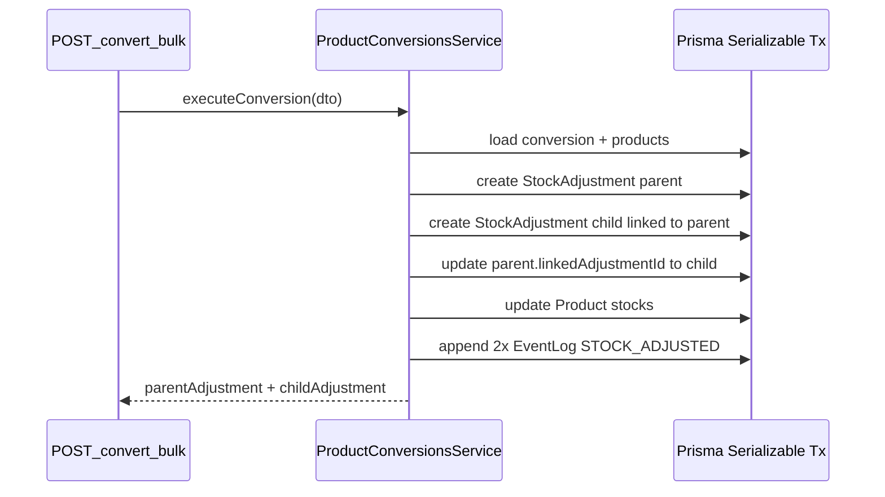

# Product Conversion (Bulk ↔ Singles)

Tenant-scoped APIs for linking pack (parent) and unit (child) products, and executing atomic inventory conversions with paired `StockAdjustment` rows.

**Global prefix:** `/api/v1`  
**Auth:** `Authorization: Bearer <accessToken>`  
**Tenant:** JWT must include `organizationId` (`TenantGuard`).  
**Roles:** See each endpoint.

---

## Schema

### `ProductConversion` (`product_conversions`)

| Field | Type | Notes |
|-------|------|--------|
| `id` | UUID | PK |
| `organizationId` | UUID | FK → Organization (cascade) |
| `parentProductId` | UUID | Bulk/pack product |
| `childProductId` | UUID | Singles/unit product |
| `conversionRatio` | Decimal(10,3) | Singles per **one** pack |
| `isActive` | Boolean | `false` disables `convert-bulk` for this row |
| `createdAt` / `updatedAt` | DateTime | |

- **Unique:** `(organizationId, parentProductId, childProductId)` — one row per pair per org.
- **Cascade:** deleting org or either product removes conversion rows.

### `StockAdjustment`

| Field | Type | Notes |
|-------|------|--------|
| `linkedAdjustmentId` | UUID? **@unique** | FK → other leg of the same conversion transaction (`onDelete: SetNull`) |

---

## Business rules

### Cost-neutral financial impact

Both legs use the **parent product’s** `costPrice`:

- `unitCostPerSingle = parent.costPrice / conversionRatio`
- Parent leg: `financialImpact = round(parent.costPrice × parentQtyChange)` (2 dp)
- Child leg: `financialImpact = round(unitCostPerSingle × childQtyChange)` (2 dp)
- If rounding makes `parentImpact + childImpact ≠ 0`, the **child** leg is adjusted to `-parentImpact` so net inventory valuation change is **zero**.

`child.costPrice` is **not** used for conversion adjustments.

### Quantities

- **`direction: BULK_TO_SINGLES`** — `quantity` = number of **packs** to break down.  
  - Parent: `-quantity`  
  - Child: `+quantity × conversionRatio`
- **`direction: SINGLES_TO_BULK`** — `quantity` = number of **packs** to assemble.  
  - Singles consumed: `quantity × conversionRatio`  
  - Parent: `+quantity`  
  - Child: `-quantity × conversionRatio`

### Stock checks

- `BULK_TO_SINGLES`: `parent.currentStock >= quantity`
- `SINGLES_TO_BULK`: `child.currentStock >= quantity × conversionRatio`

### Cycle detection (transitive)

Directed graph: each conversion is an edge **parent → child**.

- **Create:** collect **all** conversion rows for the org (active and inactive), add virtual edge `(parentProductId, childProductId)`. If there is a path from **child** to **parent**, reject (**400**).
- **PATCH `isActive: true`** when currently inactive: same reachability check from child to parent over **all** stored edges (including this row while still inactive).

Self-edge (`parent === child`) is rejected.

### Transactions

`POST /inventory/convert-bulk` runs in a **serializable** transaction: create parent adjustment → child adjustment (with `linkedAdjustmentId` → parent) → update parent row’s `linkedAdjustmentId` → update both products’ `currentStock` → append two `STOCK_ADJUSTED` event log entries. All succeed or all roll back.

### Hard delete vs deactivate

- **`DELETE /products/conversions/:id`** — removes the conversion row (HTTP **204**). Historical `StockAdjustment` rows remain; paired legs still reference each other unless a row is deleted (FK `SetNull` only applies when a **StockAdjustment** is deleted).
- **PATCH** with `{ "isActive": false }` — keeps the row; execution returns **409** if inactive.

---

## Endpoints

### `POST /products/conversions`

Create a conversion relationship.

| | |
|---|---|
| **Roles** | ADMIN, MANAGER |
| **Status** | **201** |

**Body**

```json
{
  "parentProductId": "uuid",
  "childProductId": "uuid",
  "conversionRatio": 12
}
```

**Response** — created conversion + nested product names/skus (ratio as string).

**Errors**

| Code | When |
|------|------|
| 400 | Validation, self-reference, cycle, inactive products |
| 404 | Product missing / wrong org |
| 409 | Duplicate pair (`@@unique`) |

---

### `GET /products/:productId/conversions`

List conversions where the product is parent (`asParent`) or child (`asChild`).

| | |
|---|---|
| **Roles** | ADMIN, MANAGER, STAFF |
| **Status** | **200** |

**Response**

```json
{
  "asParent": [
    {
      "id": "uuid",
      "childProduct": { "id": "uuid", "name": "...", "sku": null },
      "conversionRatio": "12.000",
      "isActive": true
    }
  ],
  "asChild": []
}
```

---

### `PATCH /products/conversions/:conversionId`

Update `conversionRatio` and/or `isActive` only.

| | |
|---|---|
| **Roles** | ADMIN, MANAGER |
| **Status** | **200** |

**Body** (both optional)

```json
{
  "conversionRatio": 24,
  "isActive": false
}
```

**Errors:** 400 (validation, cycle on reactivate), 404.

---

### `DELETE /products/conversions/:conversionId`

Hard delete.

| | |
|---|---|
| **Roles** | ADMIN, MANAGER |
| **Status** | **204** (no body) |

**Errors:** 404.

---

### `POST /inventory/convert-bulk`

Execute one conversion in one transaction.

| | |
|---|---|
| **Roles** | ADMIN, MANAGER |
| **Guards** | `TenantGuard`, `OrganizationStatusGuard`, `RolesGuard` |
| **Status** | **200** |

**Body**

```json
{
  "conversionId": "uuid",
  "parentProductId": "uuid",
  "childProductId": "uuid",
  "quantity": 2,
  "direction": "BULK_TO_SINGLES",
  "notes": "Optional",
  "branchId": "optional-branch-uuid"
}
```

Provide **`conversionId`** **or** both **`parentProductId`** and **`childProductId`**.

**Response** — `{ "parentAdjustment": { ... }, "childAdjustment": { ... } }` with decimal fields as strings, `linkedAdjustmentId`, `product`, `user`, etc.

**Errors**

| Code | When |
|------|------|
| 400 | Validation, insufficient stock |
| 404 | Conversion / branch not found |
| 409 | Conversion inactive |

---

### `GET /inventory/adjustments` (enhanced)

| | |
|---|---|
| **Roles** | ADMIN, MANAGER |

**New query param**

- `type` — optional `StockAdjustmentType` enum value (e.g. `BULK_TO_SINGLES`). When set, results are **only** that type (default exclusion list for sale/stock-take etc. does not apply).

**Response items** now include:

- `linkedAdjustmentId`
- `linkedAdjustment` (if present): `{ id, type, quantityChange (string), product: { id, name, sku } }`

---

## Example: curl

```bash
# Create conversion
curl -sS -X POST "$API/api/v1/products/conversions" \
  -H "Authorization: Bearer $TOKEN" \
  -H "Content-Type: application/json" \
  -d '{"parentProductId":"...","childProductId":"...","conversionRatio":12}'

# Convert 2 packs to singles
curl -sS -X POST "$API/api/v1/inventory/convert-bulk" \
  -H "Authorization: Bearer $TOKEN" \
  -H "Content-Type: application/json" \
  -d '{"conversionId":"...","quantity":2,"direction":"BULK_TO_SINGLES"}'

# List only conversion adjustments
curl -sS "$API/api/v1/inventory/adjustments?type=BULK_TO_SINGLES" \
  -H "Authorization: Bearer $TOKEN"
```

---

## Testing recommendations

1. **Create** — happy path; duplicate pair → 409; `A→B` + `B→C` + attempt `C→A` → 400.
2. **Reactivate** — inactive `C→A` with graph that would cycle → 400.
3. **convert-bulk** — stock boundaries; paired `linkedAdjustmentId`; event log count 2; rollback on failure (e.g. force child stock insufficient).
4. **Financial** — `parentImpact + childImpact === 0` after rounding correction.
5. **GET adjustments** — `linkedAdjustment` populated for conversion rows; filter `type=BULK_TO_SINGLES`.

---

## Transaction sequence (mermaid)


